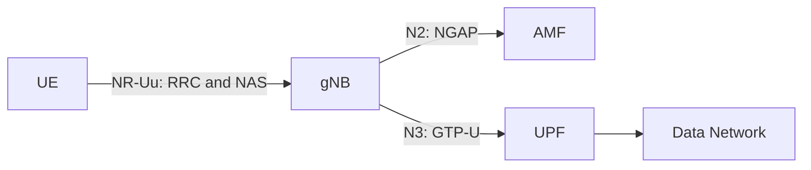

# Lab 1: Analyzing UE–gNB Connectivity in an OAI 5G SA Network(TA)

## 1. Lab Overview

In this lab, you will use Wireshark to analyze how a UE establishes an RRC connection with an OAI gNB and then registers with the 5G Core.

The main signaling path is:

```text
UE
→ RRC connection establishment
→ NAS Registration Request
→ gNB forwards the NAS message through NGAP
→ 5G Registration
→ PDU Session establishment
→ UE obtains an IP address
→ User-plane connectivity test
```

This lab focuses on the relationship between the UE and gNB. Internal 5G Core procedures such as detailed SBI and PFCP signaling are outside the main scope.

### Learning objectives

After completing this lab, you should be able to:

1. Identify the UE, gNB, AMF, UPF, and Data Network.
2. Explain the purpose of `RRCSetupRequest`, `RRCSetup`, and `RRCSetupComplete`.
3. Explain how a NAS message is transported from the UE to the AMF through the gNB.
4. Identify the main 5G Registration messages.
5. Verify that the UE receives an IP address and exchanges user-plane traffic.


### Checkpoint 1: Wireshark Setup — 10 points

Submit:

- A screenshot showing that the `OAI-5G` profile is selected. — 3 points
  

- A screenshot showing the opened capture. — 2 points
  

- A screenshot showing NR RRC packets after applying `nr-rrc`. — 5 points


---

## 5. Identify the Basic 5G SA Architecture

Use:

```text
Statistics → Endpoints → IPv4
```

Apply these filters individually:

```wireshark
ngap
```

```wireshark
gtp
```

```wireshark
icmp
```

Complete the table:

| Component | IP address | Evidence from the capture |
|---|---|---|
| UE PDU address | 10.0.0.2 | The address is shown as the source of the ICMP Echo Request in Packet 490 |
| gNB | 192.168.70.129 | Acts as the NGAP connection point to the AMF and as an endpoint for the GTP-U tunnel|
| AMF | 192.168.70.132 | IP address used by the NGAP connection between the AMF and gNB |
| UPF | 192.168.70.134 | Identified as the GTP-U endpoint for handling user-plane packets toward the data network |
| Data Network | 192.168.70.135 | 	Appears as the target address receiving the ICMP Echo Requests sent by the UE |

Complete the interface table:

| Interface | Connected components | Main protocol | Purpose |
|---|---|---|---|
| N1 | UE, AMF | NAS-5GS | Provides a logical signaling path for NAS messages between the UE and AMF. The signal is going through gNB |
| N2 | gNB, AMF | NGAP | Used to exchange control-plane information between the gNB and AMF |
| N3 | gNB and UPF | GPT-U | Transports user data packets from the gNB to the UPF  |

The logical architecture is:



### Checkpoint 2: Basic Architecture — 10 points

- Correctly identify the five components and their IP addresses. — 5 points
- Correctly explain N1, N2, and N3. — 5 points

---

## 6. Analyze the RRC Connection Establishment

Apply:

```wireshark
nr-rrc
```

Find the following messages in order:

1. `RRCSetupRequest`
2. `RRCSetup`
3. `RRCSetupComplete`

You may also try these specific filters:

```wireshark
nr-rrc.rrcSetupRequest_element
```

```wireshark
nr-rrc.rrcSetup_element
```

```wireshark
nr-rrc.rrcSetupComplete_element
```

Complete the table:

| Message | Direction | Logical channel / SRB | Main purpose | Packet number |
|---|---|---|---|---:|
| RRCSetupRequest | UE to gNB | UL-CCCH/SRB0 | The UE request the gNB to establish connection | 104 |
| RRCSetup | gNB to UE | DL-CCCH/SRB0 | The gNB sets up the configuration to RRC to establish connection ewith SRB1 | 105 |
| RRCSetupComplete | UE to gNB | UL-CCCH/SRB1 | The UE confirms that RRC setup is complete and takes the registration request | 108 |

RRC setup request (pachet 104)

RRC setup (packet 105)

RRC setup complete (packet 108)

mo-signalling 

Answer the following questions:

1. What is the establishment cause in `RRCSetupRequest`?
The establishment cause is mo-Signalling. It means the UE is requesting an RRC connection to send signaling messages toward the network.
2. What SRB does `RRCSetupRequest` use? Why?
RRCSetupRequest is sent using SRB0. Because SRB0 is used for the initial RRC signaling before a dedicated signaling radio bearer has been established. It is carried on CCCH.
3. Which side sends `RRCSetup`?
 The gNB sends RRCsetup to the UE. 
4. Which signaling radio bearer is used after the RRC connection is established?
After RRC establishment, SRB1 is used for dedicated RRC signaling and NAS messages.
5. Which NAS message is carried inside `RRCSetupComplete`?
he RRCSetupComplete message carries a NAS Registration Request.
6. At the end of this procedure, is the UE only connected to the gNB, or is it already registered with the 5G Core? Explain.
At the end of RRC connection establishment, the UE is RRC-connected to the gNB, but the 5G Core  

### Checkpoint 3: RRC Connection Establishment — 35 points

- Identify all three RRC messages with packet numbers and screenshots. — 12 points
- Correctly identify message directions. — 6 points
- Correctly identify UL-CCCH, DL-CCCH, SRB0, and SRB1 usage. — 7 points
- Explain the purpose of each message. — 6 points
- Explain the difference between RRC connection and 5G Registration. — 4 points

---

## 7. Connect RRC Signaling to NGAP and NAS

The UE exchanges NAS signaling with the AMF through the gNB. On the radio side, the NAS message is carried by RRC. The gNB then forwards it to the AMF through NGAP.

First, locate `RRCSetupComplete` using:

```wireshark
nr-rrc
```

Expand:

```text
RRCSetupComplete
→ dedicatedNAS-Message
→ Registration Request
```

Then apply:

```wireshark
ngap && nas-5gs
```

Locate:

```text
InitialUEMessage
→ NAS-PDU
→ Registration Request
```

Compare the two packets:

| Stage | Protocol message | Sender → receiver | Encapsulated information |
|---|---|---|---|
| Radio side | RRCSetupComplete | UE to gNB | Registration request in dedicated NAS message |
| Core side | NGAP InitialUEMessage | gNB to AMF | Registration request in NAS- PDU |

RRC setup compplete 

NGAP initialUEmessage 

Answer:

1. What is the role of the gNB when it transports NAS messages?
The gNB acts as a transport/relay for NAS messages between the UE and the 5G Core.
2. What is the difference between RRC and NAS signaling?
RRC signaling manages the wireless connection directly between the UE and the gNB, while NAS signaling is exchanged between the UE and the AMF for core network procedures such as registration and authentication.
3. Is the Registration Request delivered directly from the UE to the AMF? Explain the protocol path.
Logically, yes, but physically it is transported through the gNB.
4. Which message confirms that Registration has completed successfully?
The registration complete message confirms that the AMF has successfully accepted the UE's registration.
### Checkpoint 4: RRC-to-NGAP/NAS Mapping — 25 points

- Show the Registration Request inside `RRCSetupComplete`. — 6 points
- Show the Registration Request inside NGAP `InitialUEMessage`. — 6 points
- Correctly complete the mapping table. — 5 points
- Explain the roles of RRC, NGAP, NAS, gNB, and AMF. — 5 points
- Identify Registration Accept and Registration Complete. — 3 points

---

## 8. Verify the UE IP Address and User-Plane Traffic

Apply:

```wireshark
nas-5gs || ngap
```

Find the PDU Session Establishment Accept and record the UE address:

| Field | Observed value |
|---|---|
| UE IPv4 address | 10.0.0.2 |
PDU Session Establishment 

Apply:

```wireshark
gtp || icmp
```

Find one ICMP Echo Request and its Echo Reply. Confirm that the UE's IP packet is carried inside GTP-U between the gNB and UPF.
ICMP Echo Request/Reply (885/884)

Answer:

1. What IPv4 address was assigned to the UE?
The UE was assigned the IPv4 address 10.0.0.2.
2. How many ICMP Echo Request/Reply pairs are present?
There are 10 IMCP echo resquest/reply
3. What does the successful Echo Reply prove about the UE connection?
It confirms that the UE has successful end-to-end connectivity through the 5G network to the Data Network, meaning the user-plane path is working correctly.
### Checkpoint 5: UE IP and User Plane — 15 points

- Identify the UE IPv4 address in the PDU Session Establishment Accept. — 6 points
- Show one ICMP Echo Request and its Echo Reply. — 5 points
- Explain what the successful ping proves. — 4 points

---

## 9. Final UE Connection Sequence

Create one sequence diagram containing:

- UE
- gNB
- AMF
- UPF
- Data Network

Include at least:

1. RRCSetupRequest
2. RRCSetup
3. RRCSetupComplete with Registration Request
4. NGAP InitialUEMessage
5. Authentication
6. Security Mode
7. Registration Accept and Complete
8. PDU Session establishment
9. GTP-U ping


## 10. Submission and Grading

Submit one PDF or Markdown report containing:

- Completed tables
- Answers to all questions
- Packet numbers
- Required screenshots
- Final sequence diagram

Each screenshot must show:

- The display filter
- Packet number
- Info column
- Expanded protocol fields supporting your answer

| Checkpoint | Topic | Points |
|---:|---|---:|
| 1 | Wireshark profile and NR-RRC decoding | 10 |
| 2 | Basic 5G SA architecture | 10 |
| 3 | RRC connection establishment | 35 |
| 4 | RRC-to-NGAP/NAS mapping | 25 |
| 5 | UE IP and GTP-U user plane | 15 |
| 6 | Final sequence diagram | 5 |
|  | **Total** | **100** |

---
